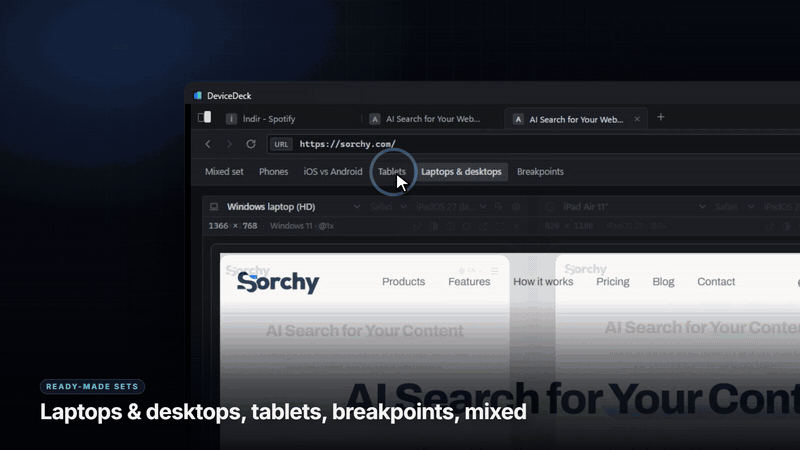

<h1 align="center">DeviceDeck</h1>

<p align="center">
  See and test any website as an iPhone, Android phone, iPad, Android tablet, Windows PC, Mac, Chromebook or Linux computer — side by side, at the same time.
</p>

<p align="center">
  <a href="../../releases/latest"></a>
  <a href="../../actions/workflows/ci.yml"></a>
  
</p>

<p align="center">
  <a href="docs/DeviceDeck-demo.mp4"></a>
  <br>
  <a href="docs/DeviceDeck-demo.mp4">▶ Watch the full demo video (2:35)</a>
</p>

Each device preview is a real browser view that tells websites it **is** that device: browser name (user agent), system, screen size, pixel density, touch screen, pointer and hover. Works on every website — no add-ons, no setup.

## Install

Download the file for your computer from **[Releases](../../releases/latest)**:

| System | File |
| --- | --- |
| Windows 10 / 11 | `DeviceDeck_x.y.z_x64-setup.exe` (or `.msi`) |
| macOS, Apple Silicon | `DeviceDeck_x.y.z_aarch64.dmg` |
| macOS, Intel | `DeviceDeck_x.y.z_x64.dmg` |
| Linux | `.deb`, `.rpm` or `.AppImage` |

> [!NOTE]
> The installers are not code-signed yet. **Windows:** on the SmartScreen warning, click **More info** → **Run anyway**. **macOS:** if it says the app "is damaged", run `xattr -cr /Applications/DeviceDeck.app` once.

The full set of faking powers (request headers, client hints, device-shaped screens, screenshots) is Windows-only for now; on macOS and Linux each device gets its size, user agent and in-page faking.

## Features

- **Many devices side by side** — 24 built-in phones, tablets, laptops and desktops, or any custom size. Rotate, resize, and switch between Row, Grid, Focus and Free layouts.
- **Real device identity** — pick the browser (Safari, Chrome, Firefox, Edge, Samsung Internet) and system version (iOS 16–27, Android 12–17, macOS 13–27, Windows 10–11) per device.
- **True screen shapes** — rounded corners and the Dynamic Island or punch-hole camera, at their real size and place.
- **Everything in sync** — scrolling, clicks and typing are mirrored on every device.
- **Developer tools** — DevTools for any device, light / dark mode, full-page screenshots of every device in one click.
- **Rate-limit friendly** — devices load one after another and retry by themselves on HTTP 429.

## Use it with AI assistants

DeviceDeck has a built-in [MCP](https://modelcontextprotocol.io) server, so assistants like Claude Code or Cursor can open sites on any device, check layouts and take screenshots:

```bash
claude mcp add --transport http devicedeck http://127.0.0.1:12721/mcp
```

<details>
<summary>Available tools</summary>

The server only runs while DeviceDeck is open (`curl http://127.0.0.1:12721/health`).

| Tool | What it does |
| --- | --- |
| `get_status` / `get_app_state` | Whether the app is responding; address, tabs, layout and every device. |
| `list_devices` / `set_devices` | Device profiles, e.g. `["iphone-15:chrome", "pixel-8", "custom:1280x800:windows:laptop"]`. |
| `navigate` / `reload` | Open or reload and wait until the devices have loaded. |
| `screenshot` | PNGs of the visible part or the `full_page`. |
| `read_page` | Title, address and text. |
| `click` / `type_text` | By CSS selector. |
| `run_script` | Run JavaScript on one or more devices and return the result. |
| `check_layout` | Sideways scrolling, overflowing elements, tiny text and small tap targets. |

`device` accepts `all`, a pane id, a device id or part of a name.
</details>

## Stats

<p align="center">
  
</p>

## Build from source

Requirements: [Node.js](https://nodejs.org) 20+, [Rust](https://rustup.rs) (the version is picked automatically) and the [Tauri system dependencies](https://tauri.app/start/prerequisites/) for your OS.

```bash
git clone https://github.com/dhia-eddine-mahdaoui/devicedeck.git
cd devicedeck
npm ci
npm run desktop   # installers land in src-tauri/target/release/bundle
```

## Security

The MCP server listens only on `127.0.0.1` and refuses requests from web pages and DNS-rebinding attempts. DeviceDeck has no telemetry and needs no API keys. Please report security issues through GitHub's private vulnerability reporting (Security tab).

## Contributing

Issues and pull requests are welcome — see [CONTRIBUTING.md](CONTRIBUTING.md).

## License

© 2026 Dhia Mahdaoui. DeviceDeck is open source under the [GNU Affero General Public License v3.0](LICENSE): you can use, change and share it freely, as long as anything you distribute or host that is based on it is released under the same license with its source code.

**Commercial license:** want to use DeviceDeck in a closed-source product or service, without the AGPL obligations? [Open an issue](../../issues) to ask about a commercial license.

## Code signing

Free code signing for the Windows installers by [SignPath.io](https://about.signpath.io), certificate by [SignPath Foundation](https://signpath.org) — the application is in progress; until it is approved, the installers are unsigned (see [Install](#install)). See the [code signing policy](CODE_SIGNING.md).
